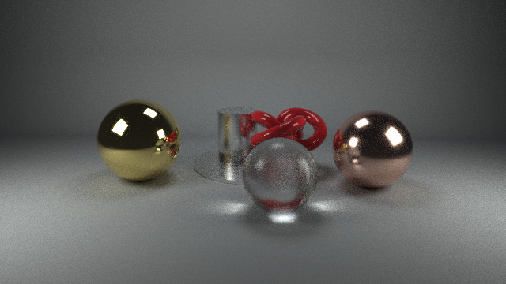
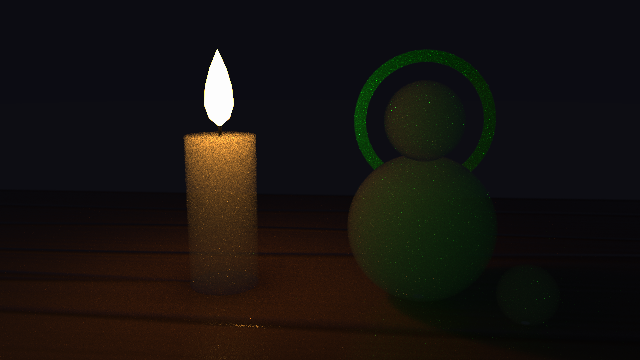
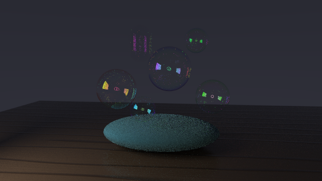
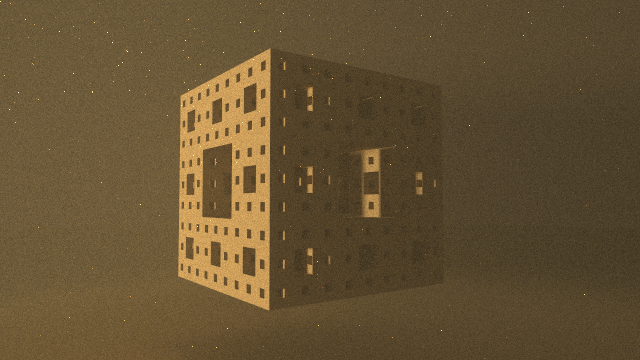
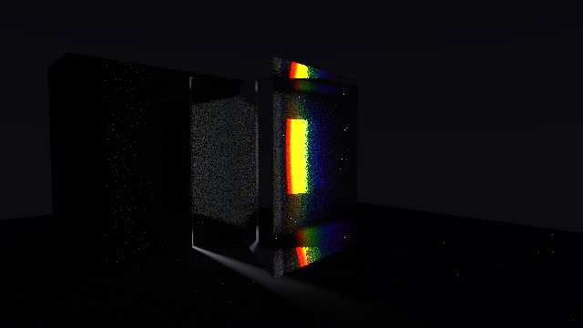
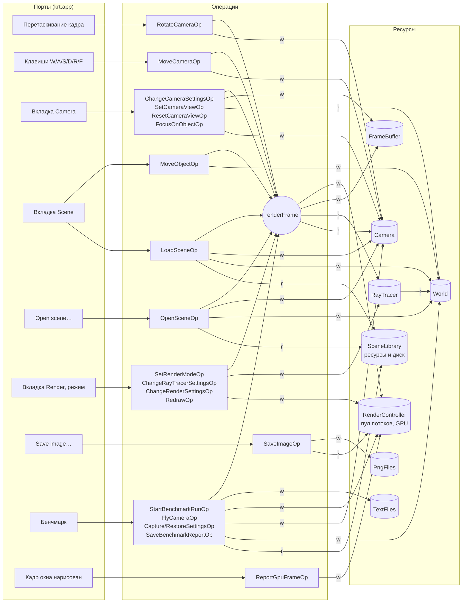

# krt

Трассировщик лучей на Kotlin + Compose Desktop. Каждый пиксель считается на CPU кодом на Kotlin; отдельный GPU-режим считает тот же кадр SkSL-шейдером через Skia. Сцены — файлы [pbrt-v4](https://pbrt.org/fileformat-v4) или OBJ + MTL с JSON-описанием материалов.

 
 

## Запуск

Нужен JDK 17+.

```bash
./gradlew run      # приложение
./gradlew check    # тесты, detekt, Konsist
./gradlew jmh      # бенчмарки ядра (в check не входят)
```

Сцены выбираются на вкладке Scene (см. «Сцены» ниже), свои открываются кнопкой «Open scene…». Камера: `W/A/S/D` или стрелки, `R`/`F` — вверх/вниз, перетаскивание по кадру поворачивает. Секундомер в верхней панели запускает бенчмарк-пролёт камеры.

Правила кода: [AGENTS.md](AGENTS.md), решения: [docs/adr](docs/adr/README.md).

## Сцены

Кадры выше и ниже посчитаны на CPU, 640×360, 256 сэмплов на пиксель.

| Сцена | Что показывает |
| --- | --- |
| Showcase | Вечерняя сцена с процедурными сетками: панели, икосферы, торы, торические узлы. |
| Materials | Все физические материалы рядом: дисперсия, плёнки, микрограни, SSS, бархат, узоры, свечение, размытие движения. |
| Fractals | Mandelbulb, губка Менгера, Mandelbox и кватернионная Жюлиа на шахматном полу. |
| Prism | Тёмная комната, лампа в коробе с высокой узкой щелью, луч в дымке и призма из флинта у угла наименьшего отклонения; камера стоит в веере лучей, и щель видна сквозь призму радугой — светом прямо от лампы, а не каустикой, поэтому кадр сходится быстро. |
| Bubbles | Мыльные пузыри с плёнкой от 300 до 560 нм над бархатной подушкой, один всплывает с размытием движения; окно и кольцевая лампа, отражённая в каждом пузыре. |
| Candle & jade | Свеча из воска и фигурка из нефрита, светящиеся изнутри от пламени 1800 K с облачным узором. |
| Fractal temple | Губка Менгера в дымке, камера внутри дымки, низкое солнце 3000 K сбоку светит сквозь отверстия. Лучи в дымке слабые: дымка krt рассеивает свет поровну во все стороны, а заметные лучи дают среды, рассеивающие вперёд. |
| Metals | Золото и медь по комплексному показателю преломления, шлифованный алюминий, матовое стекло, автомобильный лак, три софтбокса. |
| Classic | Россыпь шаров из первой версии; на ней golden-тест. |



Сцены Prism, Bubbles, Candle & jade, Fractal temple и Metals собирает код (`ShowcaseScenes` в тестах) и пишет в pbrt-v4; тест сверяет файлы со сборщиком и держит каждую сцену в пределах нагрузки: меньше 50 000 треугольников, от одного до шести источников, не больше двух фракталов, дымка только в небольшом объёме. Перезаписать файлы после правки сборщика: `./gradlew test --tests '*ShowcaseScenesTest*' -Dkrt.writeScenes=true`.

## Как считается каждый эффект

Кадр — оценка Монте-Карло уравнения рендеринга: из пикселя выпускаются лучи, на каждом попадании материал выбирает направление следующего луча и вес пути (`Material.scatter`), излучение источников, встреченное по пути, суммируется с этим весом. Пиксель — среднее по сэмплам. Каждая формула ниже есть дважды: в Kotlin (`krt.domain`) и построчно в шейдере (`path_tracer.sksl`).

| Эффект | Где | Математика |
| --- | --- | --- |
| Камера, глубина резкости | `Camera`, `Lens` | Тонкая линза: начало луча — случайная точка диска радиуса `aperture/2`, луч проходит через точку на плоскости фокуса на расстоянии `focusDist`. Смещение внутри пикселя случайно — сглаживание. |
| Поиск попадания | `Bvh`, `TraceScene` | Дерево ограничивающих коробок: узел делится по медиане центров вдоль самой длинной оси. Обход без стека, на GPU — по ссылкам «следующий узел» в текстуре сцены. Шар: квадратное уравнение; треугольник: Мёллер — Трумбор. |
| Диффузная поверхность | `Lambert` | Направление — нормаль плюс случайная точка в единичном шаре; плотность таких направлений 2cos³θ/π, её же использует выборка источников (ADR 0012). |
| Зеркальный металл | `Metal` | Отражение r = d − 2(d·n)n плюс случайный сдвиг в шаре радиуса `fuzz`. |
| Стекло | `Dielectric` | Закон Снеллиуса для преломления, полное внутреннее отражение при η·sinθ > 1, доля отражения — приближение Шлика R = R₀ + (1 − R₀)(1 − cosθ)⁵; луч выбирает ветвь с этой вероятностью. Окраска — поглощение по закону Бугера — Ламберта на пройденном пути. |
| Дисперсия | `Dielectric.dispersion`, `Spectrum` | Формула Коши n(λ) = A + B/λ². Белый луч при первом входе в стекло выбирает длину волны равномерно в 380–720 нм, вес пути — цвет этой волны, нормированный так, что среднее по спектру белое. Оценка несмещённая. |
| Тонкая плёнка | `ThinFilm`, `SoapBubble`, `Iridescent` | Формула Эйри для одной плёнки толщины d и показателя n: интерференция отражений от двух границ с разностью хода 2nd·cosθₜ, среднее двух поляризаций, на длинах волн каналов RGB. |
| Микрограни, анизотропия | `Microfacets`, `Conductor` | Распределение GGX с шириной αₓ, α_y; выборка видимых нормалей (Heitz 2018), затенение Смита G2/G1. Касательная задаёт направление шлифовки. Шероховатость pbrt переводится в α. |
| Металлы по η и k | `ConductorFresnel`, `Metals` | Точная формула Френеля для проводника с комплексным показателем η + ik; для золота, меди, хрома, серебра, алюминия — измеренные значения на линиях RGB. |
| Матовое стекло | `Dielectric.roughness` | Отражение и преломление на нормали микрограни GGX; лучи, ушедшие не на ту сторону поверхности, гаснут. |
| Пластик, лак | `Plastic`, `Patterned` | Прозрачный лак по Шлику над диффузной основой: с вероятностью Френеля зеркальное отражение, иначе Ламберт. |
| Бархат | `Velvet`, `Sheen` | Блеск ворса — распределение Charlie с видимостью Нойбельта; ветвь (диффузная или блеск) выбирается случайно, вес делится на её вероятность. |
| Среды: туман, дым, воск | `Medium`, `FreeFlight`, `Fog` | Однородная среда с коэффициентом ослабления σₜ и альбедо по каналам RGB. Длина свободного пробега выбирается по экспоненциальному закону для случайного канала, вес — по спектральному MIS (среднее плотностей каналов). Пропускание — закон Бугера — Ламберта T = exp(−σₜ·s). Частица рассеивает по фазовой функции Хеньи — Гринштейна p(cosθ) = (1 − g²) / (4π (1 + g² − 2g cosθ)^{3/2}) со средним косинусом g: при g = 0 поровну во все стороны, при g → 1 вперёд, как дымка, дающая лучи; направление выбирается точно по p, выборка источников умножает свет на p. Путь помнит, в какой среде он идёт; границы сред — поверхности с `MediumInterface` (ADR 0014). |
| Подповерхностное рассеяние | `Translucent` | Стеклянная поверхность и среда внутри той же сферы: случайное блуждание между частицами, пока луч не выйдет через поверхность. |
| Выборка источников (NEE) | `Lights`, `Emitters`, `PathTracing.direct` | На каждом диффузном отскоке — теневой луч к случайной точке на источнике. Источник выбирается с вероятностью ∝ площадь × яркость (треугольники одного объекта — один источник, бинарный поиск по накопленным долям). Вклад: Le · f · cosθ · cosθₗ / (r² · p). Излучение, встреченное после такого отскока, не считается дважды. Теневой луч проходит сквозь границы сред и умножается на их пропускание (ADR 0012). |
| Свечение по температуре | `Emissive.kelvin`, `Blackbody` | Спектр Планка B(λ, T), свёрнутый с весами каналов и нормированный к яркости 1, как в pbrt-v4. |
| Процедурные узоры | `Noise`, `Pattern` | Улучшенный шум Перлина; fBm — сумма октав с удвоением частоты и уменьшением амплитуды вдвое; турбулентность — сумма модулей. Мрамор: sin(f·x + k·turbulence). Дерево: кольца — дробная часть f·√(y² + z²) с шумом, ствол вдоль x. Сетка — дробная часть координат, полосы — синус по y. Хеш решётки (34x² + x) mod 289 точен во float32, поэтому шейдер рисует тот же узор. |
| Рельеф (bump) | `Bump` | Нормаль наклоняется против градиента значения узора; градиент — конечными разностями. |
| Размытие движения | `SceneLook.motionBlur`, `Sphere.velocity` | Луч камеры получает случайный момент t ∈ [0, 1); центр шара в этот момент c + v·t. Коробка шара охватывает весь его путь. |
| Гладкие нормали | `VertexNormals`, `Meshes.smooth` | Нормаль в точке — смесь нормалей вершин по барицентрическим координатам; сторона попадания — по плоской грани. |
| Фракталы | `Fractal`, `FractalDistance` | Трассировка сферами по оценке расстояния d(p): шаг вдоль луча на d, пока d < 10⁻⁴·радиус, не больше 160 шагов; нормаль — градиент d по четырём точкам тетраэдра. Mandelbulb: d = ½·ln r·r/dr, dr ← p·rᵖ⁻¹·dr + 1. Губка Менгера: пересечение куба с крестами дыр на каждом уровне (масштаб 3). Mandelbox: складка коробки, складка сферы, масштаб; d = \|z\|/\|dr\|. Кватернионная Жюлиа z ← z² + c: d = ¼·√(\|z\|²/\|z′\|²)·ln \|z\|² (ADR 0015). |
| Прогрессивный кадр | `RenderController`, `FrameSampling` | Пиксель — среднее сэмплов всех проходов. На GPU шаги идут полосами строк, кадр хранит √(среднего) в 8 битах (гамма 2) и смешивается со следующим шагом; бюджет шага подстраивается под время кадра окна (ADR 0010). |
| Wireframe | `Wireframe` | Рёбра объектов проецируются камерой и растеризуются алгоритмом Брезенхэма в Kotlin. |

## Диаграмма эффектов

Диаграмма по [Эргономичной архитектуре](https://github.com/ergonomic-code/ergo-wiki/blob/2b77b9c/kb/production-code/models/ergo-arch.adoc): порты (обработчики событий Compose) вызывают операции, операции читают (r) и пишут (w) ресурсы. Почти каждая операция заканчивается доменной операцией `renderFrame`: она читает камеру и сцену и запускает кадр в `RenderController`. Трансформации (материалы, ядро трассировки, разбор файлов сцен) на диаграмме не показаны: они чистые и эффектов не имеют.



## Тесты CPU и GPU

- Ядро на CPU: модульные тесты трансформаций и golden-кадр Classic с фиксированным seed (`TracedFrameGoldenTest`).
- GPU-шейдер: `GpuTracerTest` рисует ту же сцену шейдером и ядром и сравнивает среднюю яркость каналов и четвертей кадра, по одному тесту на эффект. Шейдер исполняет растровый конвейер Skia на CPU в float32, без видеокарты, поэтому тесты идут в CI. Шейдер разложен по частям рядом с Kotlin, который он повторяет, общие константы генерируются из Kotlin (`GpuShaderSource`, ADR 0009).
- Настоящая видеокарта: `./gradlew gpuSmoke` рисует каждую встроенную сцену во всех размерах бенчмарка на Metal без окна, шагами, как `RenderController`, и падает на шаге дольше 1 с, на кадре, который не успел за 60 с, и на чёрном или пурпурном кадре. В `check` не входит: в CI нет видеокарты. Одна сцена: `./gradlew gpuSmoke -Pscene=fractals`; тяжёлая сцена с дымкой и тысячей ламп, на которой окно зависало, — только отдельно: `-Pscene=stress`. Отчёт — `build/reports/gpu-smoke.md`.
