# krt

Десктопный трассировщик лучей на Kotlin и Compose Desktop. Откройте сцену, переместите камеру и посмотрите, как меняются отражения, тени и глубина резкости. Кадр можно рассчитать на CPU или GPU (SkSL), а геометрию рассмотреть в режиме Wireframe.

[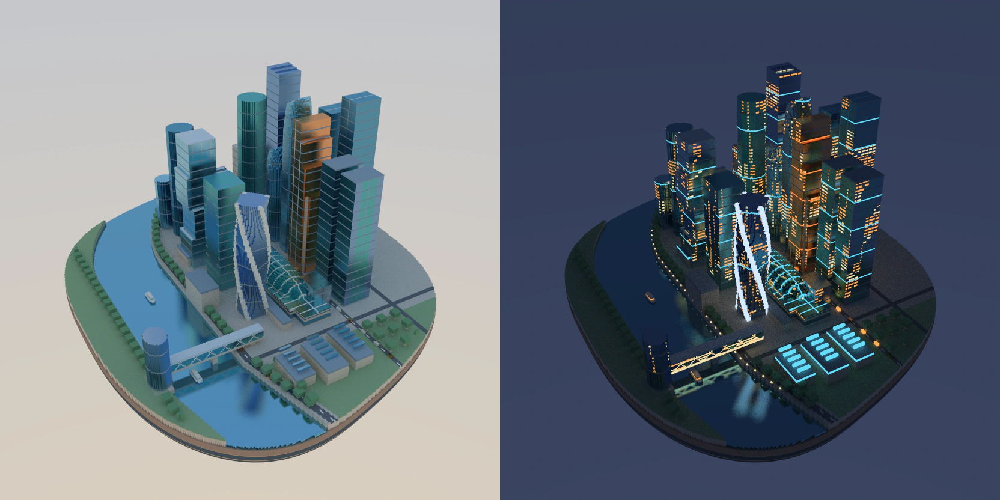](docs/images/moscow-city-day-night.webp)

**Москва-Сити, день и ночь.** Воксели размером 2,5 м образуют спираль «Эволюции», рёбра купола Афимолла и переплёт моста. На ночном кадре окна и фонари освещают набережную и отражаются в Москве-реке. Оба вида рассчитаны на CPU по 128 сэмплов на пиксель. [Открыть файлы диорамы и настройки](samples/moscow-city/README.md)

[Запуск](#запуск) · [Галерея сцен](#галерея-сцен) · [Сравнение CPU, GPU и камеры](#сравнение-режимов-и-камеры) · [Математика эффектов](#как-считается-каждый-эффект) · [Диаграмма эффектов](#диаграмма-эффектов) · [Тесты](#тесты-cpu-и-gpu)

## Галерея сцен

Все кадры рассчитаны при **256 сэмплах на пиксель** и глубине пути **10**, с включённым **Stratified pixel sampling**. Нажмите на изображение, чтобы открыть его в размере 960×540. Для тонких деталей Candle & jade и Fractal temple исходные кадры рассчитаны крупнее — 1440×810 и 1920×1080 соответственно.

| Classic spheres · CPU | Metals · GPU (Metal) |
| --- | --- |
| [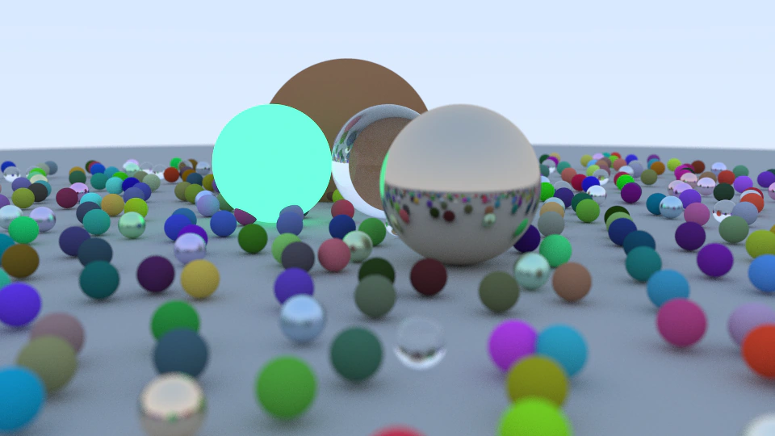](docs/images/classic.webp) | [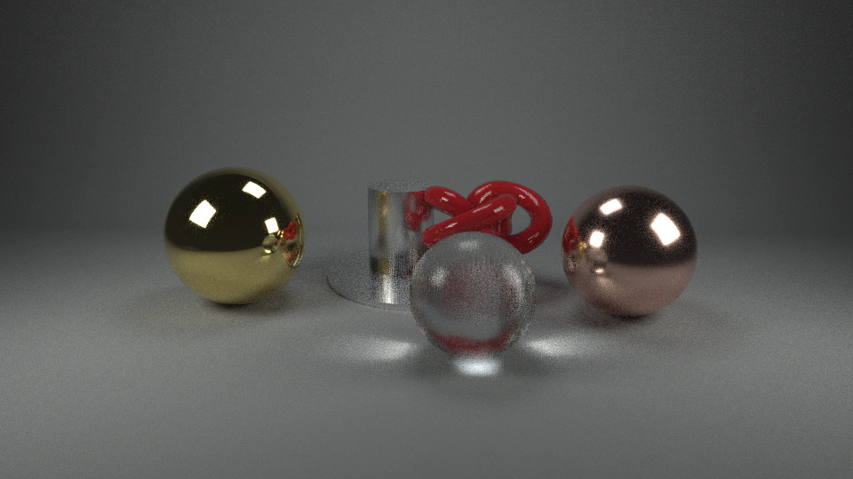](docs/images/metals.webp) |
| **32°, апертура 0,1.** Поле зрения сужено со стартовых 90°. В стеклянном шаре виден преломлённый горизонт, в полированном металле — отражение соседних шаров. | **38°, апертура 0,015.** У золота и меди разный цвет отражения. На шлифованном алюминии блик растягивается вдоль поверхности. |

| Bubbles · CPU | Prism · CPU |
| --- | --- |
| [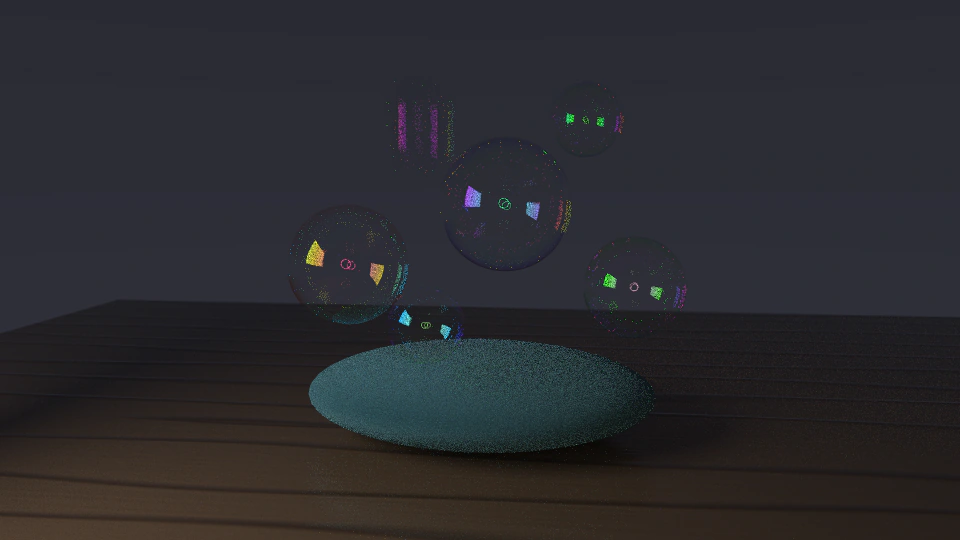](docs/images/bubbles.webp) | [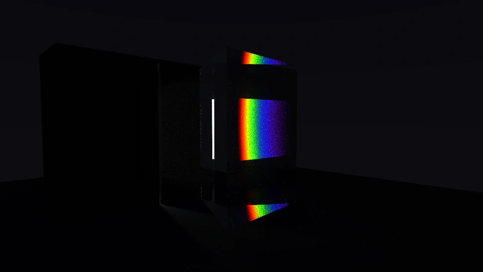](docs/images/prism.webp) |
| **40°, апертура 0,03.** Форма бликов повторяет окно и кольцевую лампу. Цвет задаёт интерференция в плёнке, а движение размывает всплывающий пузырь. | **50°, апертура 0.** Через стекло видны цветные изображения одной щели. Лучи разных длин волн преломляются под разными углами. [Проверка дисперсии](docs/scene-optics.md) |

| Candle & jade · CPU | Fractal temple · GPU (Metal) |
| --- | --- |
| [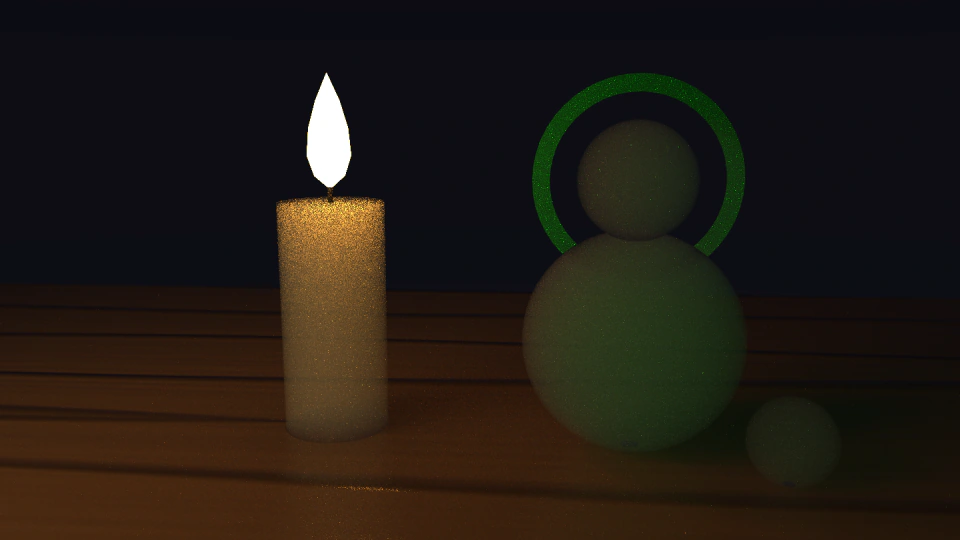](docs/images/candle.webp) | [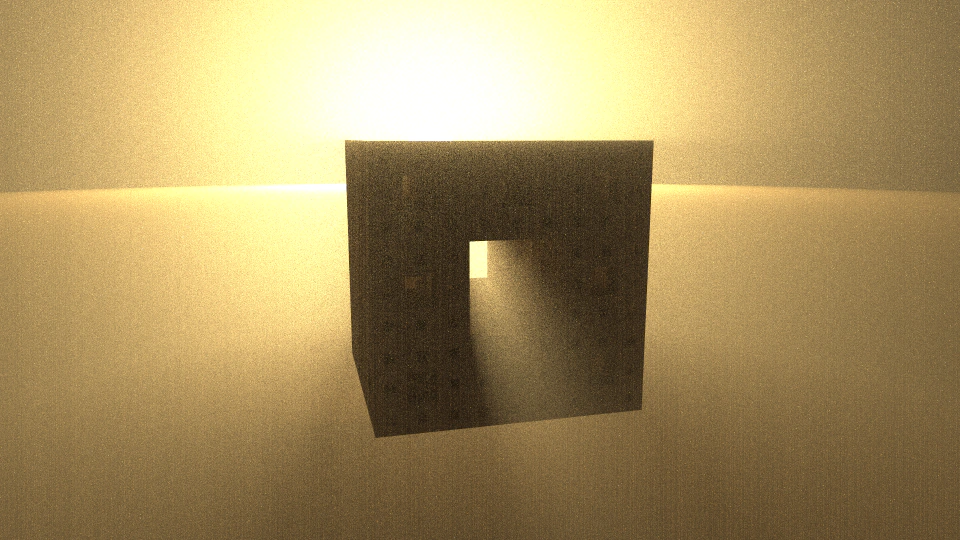](docs/images/temple.webp) |
| **34°, апертура 0,02.** Пламя подсвечивает воск изнутри. Чтобы проявить форму нефрита, у источника **Warm fill** выставлено **Emission scale = 5,6**. | **42°, апертура 0.** Низкое солнце освещает дымку в отверстиях фрактала. При *g* = 0,75 свет рассеивается преимущественно вперёд. |

| Ещё три встроенные сцены | Что рассмотреть |
| --- | --- |
| Showcase | В **Wireframe** видны рёбра икосфер, торов и узлов. При переключении на трассировку та же камера показывает освещение панелями. |
| Materials | Деревянный пол, бархат, воск, нефрит, стекло, тонкие плёнки и движущиеся шары. Ниже на этой сцене сравнены камера и режимы. |
| Fractals | Mandelbulb, губка Менгера, Mandelbox и кватернионная Жюлиа на шахматном полу. Подойдите ближе, чтобы рассмотреть отверстия и складки. |

## Запуск

С установленным JDK 22 или новее запустите приложение из корня проекта. Gradle и библиотеки включены в репозиторий. Команда работает и с пустым локальным кешем.

```bash
./gradlew --offline run
```

На Windows используйте `gradlew.bat --offline run`. Для запуска с доступом к публичным репозиториям используйте `./gradlew run`. Тесты и проверки архитектуры запускает `./gradlew check`, бенчмарки ядра — `./gradlew jmh`. На macOS аппаратный GPU-режим использует Metal. [Состав зеркала и контрольные суммы](third-party/README.md)

Откройте **Scene** и выберите встроенную сцену или нажмите **Open scene…** для загрузки pbrt-v4 или OBJ с материалами MTL. Перетаскивание поворачивает камеру, `W/A/S/D` и стрелки перемещают её, `R/F` меняют высоту.

## Сравнение режимов и камеры

Секундомер на верхней панели запускает бенчмарк пролёта. **FPS** показывает частоту кадров окна во время движения, **Done after** — время от остановки камеры до готового кадра.

Для всех четырёх кадров выставлены **400×224** и стартовая камера выбранной сцены. В режимах трассировки выставьте **Render → Samples per pixel = 32** и **Max bounces = 7**, остановите камеру и дождитесь **Done · 32/32 passes** в строке состояния. Для проверки резкости включите **1:1** в области кадра.

| Materials · CPU path tracing | Materials · GPU (SkSL), Metal |
| --- | --- |
| 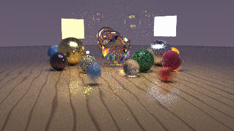 | 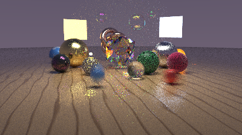 |
| **34°, Depth of field выключен.** Посмотрите на контуры площадных источников и кольца древесины на переднем плане. | **Та же камера и качество.** Сравните блики и цвет пола. Рисунок зерна меняется между прогонами из-за случайной выборки. |
| Materials · CPU path tracing | Showcase · Wireframe |
|  | 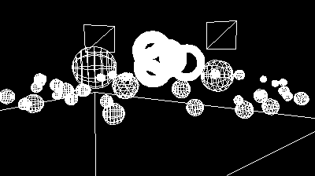 |
| Включите **Camera → Depth of field**, задайте **Aperture = 1**, оставьте стартовую **Focus distance ≈ 13,49**. Сравните ближние волокна дерева с первым кадром в таблице. | Откройте **Showcase**, выберите **Wireframe**. Поле зрения **34°**. Один проход проецирует рёбра в пиксели. |

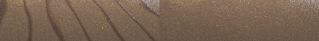

Один и тот же участок пола, по 200×52 пикселя, без интерполяции. Слева апертура 0, справа 1. В опубликованной паре CPU/Metal с апертурой 0 средние значения каждого канала RGB различаются менее чем на 0,001 по шкале 0–1 как по всему PNG, так и на выбранном участке пола.

**Деревянный пол.** В **Scene → Materials** оставьте камеру неподвижной и переключите **Filter distant wood grain**. По умолчанию фильтр включён. На CPU и GPU фильтр усредняет кольца и рельеф при первом видимом попадании в древесину. По мере увеличения заданного числа сэмплов участок усреднения для каждого луча уменьшается, поэтому близкие волокна сохраняют контраст. Чтобы увидеть исходную рябь, выключите его. Сравнивайте при **1:1** и выключенной **Camera → Depth of field**. [Сравнение ближнего и дальнего участков пола с эталоном](docs/wood-filter.md)

**Зерно.** Переключатель **Scene → Stratified pixel sampling** распределяет лучи по разным участкам каждого пикселя. Эффект особенно заметен на силуэтах. Начальный режим — независимая выборка. Для зерна от источников света и рассеяния помогает накопление сэмплов. При независимых выборках увеличение их числа вчетверо примерно вдвое уменьшает стандартную ошибку. [Сравнение CPU и Metal при одинаковом времени](docs/pixel-sampling.md)

**Свойства объекта.** Во вкладке **Scene** выберите объект в списке. Для фрактала ползунок **Fractal iterations** задаёт число итераций (1–8 для губки Менгера, 1–16 для остальных). У излучателя **Emission scale** меняет мощность света и освещение окружающих поверхностей. У объекта с объёмной средой **Volume extinction** задаёт ослабление по каналам R, G и B на единицу длины. При коэффициенте σ доля света, прошедшего расстояние d без взаимодействия, равна exp(−σd). Правка запускает новый кадр. Повторная загрузка пресета восстанавливает его исходные параметры.

Сцены Prism, Bubbles, Candle & jade, Fractal temple и Metals собирает код (`ShowcaseScenes` в тестах) и пишет в pbrt-v4; тест сверяет файлы со сборщиком и держит каждую сцену в пределах нагрузки: меньше 50 000 треугольников, от одного до шести источников, не больше двух фракталов, дымка только в небольшом объёме. Перезаписать файлы после правки сборщика: `./gradlew test --tests '*ShowcaseScenesTest*' -Dkrt.writeScenes=true`.

## Как считается каждый эффект

Кадр — оценка Монте-Карло уравнения рендеринга: из пикселя выпускаются лучи, на каждом попадании материал выбирает направление следующего луча и вес пути (`Material.scatter`), излучение источников, встреченное по пути, суммируется с этим весом. Пиксель — среднее по сэмплам. Материалы и камера реализованы в Kotlin и SkSL. Каркас растеризуется на CPU.

| Эффект | Где | Математика |
| --- | --- | --- |
| Камера, глубина резкости | `Camera`, `Lens` | Тонкая линза: начало луча — случайная точка диска радиуса `aperture/2`, луч проходит через точку на плоскости фокуса на расстоянии `focusDist`. При апертуре 0 лучи выходят из центра камеры. Полувысота поля на расстоянии z равна z·tan(FOV/2). Случайное смещение внутри пикселя усредняет покрытие границ. |
| Поиск попадания | `Bvh`, `TraceScene` | Дерево ограничивающих коробок: узел делится по медиане центров вдоль самой длинной оси. CPU держит стек индексов. GPU обходит плоский массив по ссылкам на первый узел после поддерева. Шар: квадратное уравнение; треугольник: Мёллер — Трумбор. |
| Небо | `Sky` | При выходе луча из сцены цвет равен (1 − t)·horizon + t·zenith, где t = (ŷ + 1)/2, а ŷ — вертикальная компонента единичного направления луча. |
| Диффузная поверхность | `Lambert` | Плотность направления отскока равна cos θ / π. При прямой выборке источника его вклад умножается на альбедо и тот же фактор (ADR 0012). |
| Зеркальный металл | `Metal` | Отражение r = d − 2(d·n)n плюс случайный сдвиг в шаре радиуса `fuzz`. |
| Стекло | `Dielectric` | Закон Снеллиуса для преломления, полное внутреннее отражение при η·sinθ > 1, доля отражения — приближение Шлика R = R₀ + (1 − R₀)(1 − cosθ)⁵; луч выбирает ветвь с этой вероятностью. Окраска — поглощение по закону Бугера — Ламберта на пройденном пути. |
| Дисперсия | `Dielectric.dispersion`, `Spectrum` | Формула Коши n(λ) = A + B/λ². Белый луч при первом входе в стекло выбирает длину волны равномерно в 380–720 нм, вес пути — цвет этой волны, нормированный так, что среднее по спектру белое. |
| Тонкая плёнка | `ThinFilm`, `SoapBubble`, `Iridescent` | Формула Эйри для одной плёнки толщины d и показателя n: интерференция отражений от двух границ с разностью хода 2nd·cosθₜ, среднее двух поляризаций, на длинах волн каналов RGB. |
| Микрограни, анизотропия | `Microfacets`, `Conductor` | Распределение GGX с шириной αₓ, α_y; выборка видимых нормалей (Heitz 2018), затенение Смита G2/G1. Касательная задаёт направление шлифовки. Шероховатость pbrt переводится в α. |
| Металлы по η и k | `ConductorFresnel`, `Metals` | Точная формула Френеля для проводника с комплексным показателем η + ik; для золота, меди, хрома, серебра, алюминия — измеренные значения на линиях RGB. |
| Матовое стекло | `Dielectric.roughness` | Отражение и преломление на нормали микрограни GGX; лучи, ушедшие не на ту сторону поверхности, гаснут. |
| Пластик, лак | `Plastic`, `Patterned` | Прозрачный лак по Шлику над диффузной основой: с вероятностью Френеля зеркальное отражение, иначе Ламберт. |
| Бархат | `Velvet`, `Sheen` | Блеск ворса — распределение Charlie с видимостью Нойбельта; ветвь (диффузная или блеск) выбирается случайно, вес делится на её вероятность. |
| Среды, туман, дымка | `Medium`, `FreeFlight`, `HenyeyGreenstein` | На пути длиной s остаётся доля света T = exp(−σₜ·s). Свободный пробег выбирается по экспоненциальному закону. Плотность угла рассеяния пропорциональна (1−g²)/(1+g²−2g·cosθ)³ᐟ². При g = 0 направления равновероятны, положительный g даёт преимущество движению вперёд. |
| Подповерхностное рассеяние | `Translucent` | Замкнутая поверхность отделяет внутреннюю среду. После преломления луч совершает случайное блуждание с экспоненциальной длиной шага и поглощением, пока снова не пересечёт поверхность или не исчерпает глубину пути. |
| Выборка источников (NEE) | `Lights`, `PathTracing.direct` | Источник выбирается с вероятностью, пропорциональной площади и яркости, точка на нём — равномерно по площади. Вклад равен излучению × отклику материала или среды × пропусканию, делённым на плотность выборки по телесному углу. Теневой луч проверяет видимость этой точки. |
| Светящиеся панели и узоры | `Emissive`, `GlowingPattern` | Исходящее излучение Lₑ = цвет × интенсивность. У пламени и лавы цвет зависит от координат точки. |
| Свечение по температуре | `Emissive.kelvin`, `Blackbody` | Спектр Планка B(λ, T), свёрнутый с весами каналов и нормированный к яркости 1, как в pbrt-v4. |
| Шахматный пол | `Checker` | Цвет выбирается по чётности суммы ⌊x/s⌋ + ⌊y/s⌋ + ⌊z/s⌋ для клетки шириной s. Сверху отражает прозрачный лак. |
| Процедурные узоры | `Noise`, `Pattern` | Улучшенный шум Перлина; fBm — сумма октав с удвоением частоты и уменьшением амплитуды вдвое; турбулентность — сумма модулей. Мрамор: sin(f·x + k·turbulence). Дерево: кольца — дробная часть f·√(y² + z²) с шумом, ствол вдоль x. Сетка — дробная часть координат, полосы — синус по y. Хеш решётки (34x² + x) mod 289 точен во float32, поэтому шейдер рисует тот же узор. |
| Рельеф (bump) | `Bump` | Нормаль наклоняется против градиента значения узора; градиент — конечными разностями. |
| Размытие движения | `SceneLook.motionBlur`, `Sphere.velocity` | Луч камеры получает случайный момент t ∈ [0, 1); центр шара в этот момент c + v·t. Коробка шара охватывает весь его путь. |
| Гладкие нормали | `VertexNormals`, `Meshes.smooth` | Нормаль в точке — смесь нормалей вершин по барицентрическим координатам; сторона попадания — по плоской грани. |
| Фракталы | `Fractal`, `FractalDistance` | Трассировка сферами по оценке расстояния d(p): шаг вдоль луча на d, пока d < 10⁻⁴·радиус, не больше 160 шагов; нормаль — градиент d по четырём точкам тетраэдра. Mandelbulb: d = ½·ln r·r/dr, dr ← p·rᵖ⁻¹·dr + 1. Губка Менгера: пересечение куба с крестами дыр на каждом уровне (масштаб 3). Mandelbox: складка коробки, складка сферы, масштаб; d = \|z\|/\|dr\|. Кватернионная Жюлиа z ← z² + c: d = ¼·√(\|z\|²/\|z′\|²)·ln \|z\|² (ADR 0015). |
| Прогрессивный кадр | `RenderController`, `FrameSampling` | Для n сэмплов с прежним средним M и m новых вкладов Lᵢ целевое среднее равно (nM + ΣLᵢ)/(n + m). Шаг GPU может обрабатывать только полосу строк. Черновик служит для навигации, полный кадр начинает накопление заново (ADR 0010). |
| Wireframe | `FrameSampling.wireframe`, `WireframeRaster` | Рёбра объектов проецируются камерой и растеризуются алгоритмом Брезенхэма в Kotlin. |

## Диаграмма эффектов

При выборе сцены меняются два ресурса — мир и камера. Затем доменная операция запускает новый кадр. Ниже показан путь от одного события до изображения в окне. Обозначения `r` и `w` означают чтение и запись ресурса. [Эргономичная архитектура](https://github.com/ergonomic-code/ergo-wiki/blob/2b77b9c/kb/production-code/models/ergo-arch.adoc)

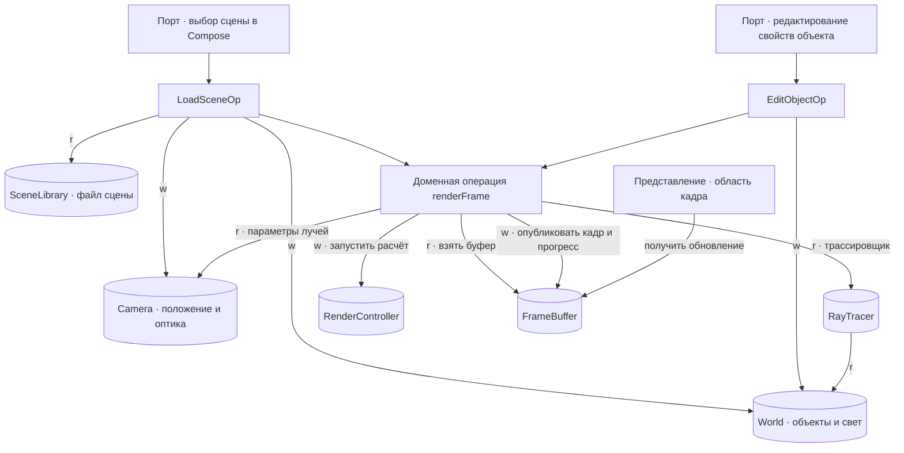

На macOS контроллер передаёт GPU-расчёт ресурсу `OffscreenGpu`, когда доступен отдельный контекст Metal. Он рисует в поверхность Skia и читает готовые строки в память кадра. В режиме со шейдером в контексте окна обратный вызов после показа сообщает контроллеру время отрисовки.

| Действие в интерфейсе | Какие ресурсы читает или изменяет операция |
| --- | --- |
| Перетаскивание кадра, движение с клавиатуры | Обновляет положение или направление `Camera`, вызывает `renderFrame`. |
| Фокусировка на выбранном объекте | Читает центр объекта из `World`, записывает расстояние фокуса в `Camera`, запускает кадр. Расстояние вычисляет чистая функция. |
| Изменение разрешения | Меняет ширину и высоту `Camera`, подбирает буфер нужного размера в `FrameBuffer`, запускает кадр. |
| Выбор режима, числа сэмплов или глубины пути | Изменяет соответственно `RenderController`, `Camera` или `RayTracer`, запускает кадр. |
| Открытие файла, перемещение или изменение оптики объекта | Читает сцену через `SceneLibrary` либо меняет положение или свойства объекта в `World`, запускает кадр. |
| Сохранение изображения | Читает кадр через `FrameBuffer` и `RenderController`, записывает PNG через `PngFiles`. |
| Бенчмарк пролёта | Сохраняет настройки сцены, камеры и рендерера, меняет их для пролёта, затем восстанавливает. Отчёт записывает через `TextFiles`. |

## Тесты CPU и GPU

Все девять стартовых сцен дополнительно проверяются на CPU в **256×160 при 48 сэмплах на пиксель**. Тест сравнивает локальный цвет, контраст тонких деталей и число выбросов. При расхождении сохраняет PNG с соответствующими строками. [Детальные кадры и допуски](docs/detail-goldens.md)

Девять встроенных сцен отрендерены также в pbrt-v4. Для матовой плоскости под площадной лампой CPU и SkSL сверяются в линейном свете с внешним эталоном. [Кадры и границы проверки по сценам](docs/scene-validation.md)

- Для каждой встроенной сцены сохранён [эталон со стартовой камеры](src/test/resources/golden/scenes). `SceneGoldenTest` ждёт полного CPU-кадра при фиксированном seed и сверяет пиксели. Затем он сравнивает SkSL с тем же PNG по участкам 8×8 отдельно для красного, зелёного и синего каналов. Для Candle & jade и Fractals на Linux x64 хранятся отдельные побитовые эталоны. В набор также входят исходные побитовые проверки Classic и каркаса.
- GPU-шейдер: `GpuTracerTest` рисует ту же сцену шейдером и ядром и сравнивает средние значения каналов RGB и отдельных областей. Для типового кадра 48×48 допуск среднего канала равен 0,03 от полной шкалы, для четверти кадра — 0,06. Отдельные тесты сравнивают узор по пикселям, разбиение на шаги и резкость. Шейдер исполняет растровый конвейер Skia на CPU в float32, без видеокарты, поэтому тесты идут в CI. Шейдер разложен по частям рядом с Kotlin, который он повторяет, общие константы генерируются из Kotlin (`GpuShaderSource`, ADR 0009).
- Настоящая видеокарта: `./gradlew gpuSmoke` рисует каждую встроенную сцену во всех размерах бенчмарка на Metal без окна, через рабочие `RenderController` и `OffscreenGpu` с общим контекстом между сценами, и падает на шаге дольше 1 с, на кадре, который не успел за 60 с, и на чёрном или пурпурном кадре. В `check` не входит: в CI нет видеокарты. Одна сцена: `./gradlew gpuSmoke -Pscene=fractals`; тяжёлая сцена с дымкой и тысячей ламп, на которой окно зависало, — только отдельно: `-Pscene=stress`. Отчёт — `build/reports/gpu-smoke.md`.

Правила кода описаны в [AGENTS.md](AGENTS.md), принятые архитектурные решения — в [ADR](docs/adr/README.md).
