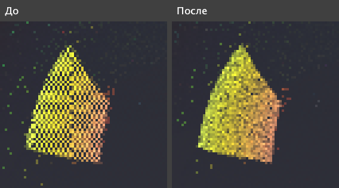

# Детальные эталоны CPU

Для каждой встроенной сцены сохранён [PNG 256×160](../src/test/resources/golden/detail) со стартовой камеры, 48 сэмплов на пиксель и глубиной пути 7. Эталоны проверяют изменения наблюдаемого кадра. Они дополняют сравнение CPU и SkSL на 64×40, аналитические проверки и [сравнение с pbrt](scene-validation.md).

Запуск: `./gradlew test --tests '*DetailGoldenTest*' --tests '*DetailDifferenceTest*'`. Каждая сцена разбита на восемь тестов по 20 строк. Координаты пикселей, лучи камеры, seed прохода и усреднение линейного RGB совпадают с правилами CPU-рендера. Начальный seed кадра здесь фиксирован и равен 42. Полоса, которая отличается от эталона сверх допуска, сохраняется в `build/reports/golden/detail`. Сообщение показывает координаты и величину ошибки. В контрольном запуске JVM с двумя доступными процессорами все 72 полосы заняли 66 секунд, самая долгая полоса Fractals — 5,58 секунды.

| Проверка | Допуск в единицах экранного канала (0–255) |
| --- | --- |
| Средняя абсолютная ошибка RGB каждой полосы | ≤ 0,16. Поскольку все полосы равны по размеру, это также верхняя граница средней ошибки полного кадра. |
| Выбросы | До восьми пикселей на 5120 пикселей полосы. Выбросом считается абсолютное различие больше 16 хотя бы в одном канале. |
| Ячейки 8×10 по всей полосе | Средняя абсолютная ошибка каждого канала ≤ 2,5. Средняя абсолютная ошибка соседних горизонтальных и вертикальных перепадов канала ≤ 4. |
| Выбранный участок сцены | Средняя ошибка знаковых перепадов RGB ≤ max(0,35; 6% от среднего абсолютного перепада эталона). Смещение яркой границы или размытие меняет перепады двух соседних пикселей. |

В каждой сцене участок покрывает видимую деталь: торический узел в Showcase, волокна пола в Materials, силуэт во Fractals, изображение щели в Prism, край пузыря в Bubbles, пламя в Candle & jade, отверстие в Fractal temple, отражение софтбокса в Metals и дальние шары в Classic spheres. Координаты заданы в [тесте](../src/test/kotlin/krt/domain/render/DetailGoldenTest.kt).

**Основание допусков.** При фиксированных сэмплах повторный расчёт на одной сборке детерминирован. Округления в геометрии и функциях JVM иногда меняют дальнейший случайный путь. В исходной паре эталонов Candle & jade 64×40 для macOS и Linux различались 40 из 2560 пикселей. Средняя ошибка по всем каналам составила 0,035, максимальное различие отдельного канала — 99. Лишь один пиксель имел различие больше 16. Допуски для детальных кадров оставляют запас для таких редких путей и отдельно ограничивают их пространственную плотность.

**Чувствительность.** Тест сравнения отвергает сдвиг всей полосы на один уровень, красную линию шириной один пиксель и длиной восемь пикселей, а также девять разнесённых ярких выбросов. Один изолированный сдвиг красного канала на 96 проходит. В контрольном эксперименте усреднение 3×3 только внутри выбранной детали нарушило допуск во всех девяти сценах. Эталонный шум Монте-Карло входит в исходный кадр, поэтому измеренный контраст включает и шум.

## Контраст в шейдере

У проверки 64×40 два независимых сигнала. Средние RGB по ячейкам 8×8 измеряют цвет. Для проверки деталей эталон 256×160 уменьшается до 64×40 усреднением по площадям пикселей. Внутри ячейки для каждого канала отклонение от среднего задаёт вес. Взвешенная разность между SkSL и малым CPU-эталоном показывает потерю контраста, даже если средний цвет ячейки сохранился. Допуск включает три единицы экранного канала и пять оценочных стандартных ошибок. Контрольная подмена Materials одноцветными блоками проходит проверку среднего цвета и проваливает проверку деталей. Тест `PbrtAreaLightTest` на машине с Metal дополнительно проверяет все три канала завершённого аппаратного кадра после накопления и чтения пикселей по независимой карте освещённости pbrt-v4.

Для каждой из девяти деталей `ShaderDetailGoldenTest` считает участок SkSL с координатами полного кадра 256×160. Шейдер делает 32 выборки на пиксель для каждого из двух фиксированных начальных значений (0,31 и 0,73). Участок CPU с 32 выборками и независимым seed 997 даёт ожидаемый цвет пикселей. Эталонный PNG с 48 выборками задаёт только пространственные веса. Это позволяет отличить устойчивые границы от шума, случайно записанного в PNG.

Проверяются два признака. Для контраста всей детали вес равен отклонению канала пикселя от среднего по участку. Для мелких границ вес равен разности между исходным каналом и его средним в окне 3×3. Для каждого признака суммируются взвешенные разности RGB между шейдером и CPU, затем сумма делится на сумму модулей весов. Допуск равен одной единице экранного канала плюс четыре оценочные стандартные ошибки. Вклад трёх каналов объединяется по пикселю, потому что каналы используют одни и те же пути лучей.

Встроенная контрольная подмена размывает только участок пламени Candle & jade фильтром 3×3. Тест требует обнаружить потерю контраста на обеих последовательностях шейдера. Для слабо выраженной текстуры пола и шумных каустик чувствительность ограничена разбросом независимых выборок. Этот тест выполняется на растровой поверхности Skia и доступен в CI. Для отдельного запуска используйте `./gradlew --offline test --tests '*ShaderDetailGoldenTest'`.

## Шум в отражении окна

В сцене Bubbles прямоугольное окно даёт блик с чёткими границами. Раньше соседние пиксели получали последовательные начальные значения генератора, и внутри блика светлые и тёмные точки чередовались. CPU теперь перемешивает ключ пикселя и прохода перед созданием генератора. Эталоны всех девяти сцен пересчитаны с прежними настройками и допусками.

Тест `BubbleHighlightTest` вычитает два расчёта одного участка 32×32 с разными начальными значениями. Геометрия блика в обоих расчётах совпадает. В разности тест измеряет связь между ошибками соседних пикселей по горизонтали и вертикали.
