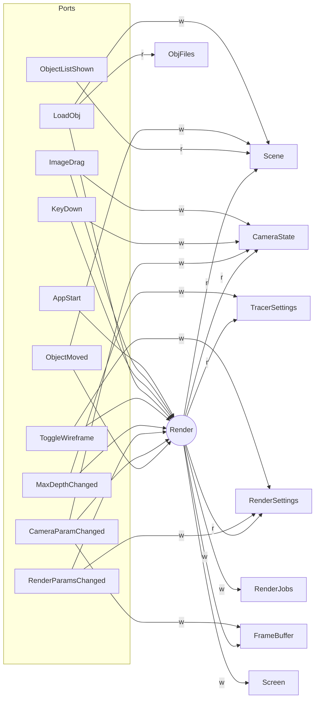

# krt — этап 1: диаграмма эффектов (черновик)

Восстановлена по коду `main` @ `7263376`. Источник формата: `ergo-wiki/kb/production-code/models/ergo-arch.adoc`, «Проекция структуры компонентов» и «Построение диаграммы эффектов». Трансформаций на диаграмме нет: только порты, операции, ресурсы и эффекты.

Адаптация к desktop: порт = обработчик UI-события Compose (вики: «обработчики событий… и т.п.»), ресурс = долгоживущий объект с изменяемым состоянием (вики: «объект может хранить состояние в памяти»).

```yaml
resources:
  Scene:          { code: "World.objects (MutableList<Traceable>)", state: in-memory, notes: "Sphere/Triangle мутируются через translate" }
  CameraState:    { code: "Camera (поза, fov, aperture, focusDist, spp, movementSpeed, imageWidth/Height)", state: in-memory }
  TracerSettings: { code: "RayTracer.maxDepth", state: in-memory, notes: "RayTracer также держит ссылку на World" }
  RenderSettings: { code: "RenderController.repaintIntervalMs, batchSize, useWireframe", state: in-memory }
  RenderJobs:     { code: "RenderController.renderJob, renderDispatcher (пул потоков), lastRepaintTime", state: in-memory }
  FrameBuffer:    { code: "BufferedImage в Main (remember + var buffer)", state: in-memory }
  Screen:         { code: "Compose state imageBitmap", state: UI }
  ObjFiles:       { code: "java.io.File в ObjParser", state: файловая система, kind: внешняя система }
  # Не ресурсы, но источники недетерминизма (глобальное окружение): kotlin.random.Random, UUID.randomUUID, System.currentTimeMillis

domain_operations:
  Render:   # вызывается из каждого порта: RenderController.renderImage(buffer, rayTracer, camera, onUpdate)
    effects:
      - read  RenderSettings.useWireframe
      - write RenderJobs: cancel previous job
      # ветка wireframe
      - read  Scene: objects.linearize
      - read  CameraState: project
      - write FrameBuffer: fill + drawLine
      - write Screen
      # ветка ray traced
      - read  CameraState: imageWidth/Height, samplesPerPixel, ray(u,v)
      - read  TracerSettings.maxDepth; read Scene: hit
      - read  RenderSettings.batchSize, repaintIntervalMs
      - write RenderJobs: launch job, lastRepaintTime
      - write FrameBuffer: setRGB (асинхронно, из пула)
      - write Screen: периодически через SwingUtilities.invokeLater, в конце напрямую из пула (TBD: поток вызова)

ports:
  AppStart (Main.main):              [ create Scene=World.default, CameraState, TracerSettings(7), RenderSettings(50,50); Render ]
  ImageDrag (Main, detectDragGestures): [ write CameraState: adjustYaw/adjustPitch; Render ]
  KeyDown (Main.handleKeyEvent):     [ write CameraState: move*; Render ]
  LoadObj (LoadObject + settingsPanel): [ read ObjFiles; write Scene: add triangles; Render ]
  ToggleWireframe (settingsPanel):   [ write RenderSettings.useWireframe; Render ]
  MaxDepthChanged (RayTracerSettings): [ write TracerSettings.maxDepth; Render ]
  RenderParamsChanged (RenderControllerSettings): [ write RenderSettings.repaintIntervalMs | batchSize; Render ]
  CameraParamChanged (CameraSettings): [ write CameraState; (guard: width,height > 50) ; maybe write FrameBuffer: replace; Render ]
  ObjectListShown (ObjectController, LaunchedEffect): [ read Scene: getObjectIds ]
  ObjectMoved (ControlPanel: Up/Down/joystick): [ write Scene: translateObjectById; Render ]
  WindowClose (Window.onCloseRequest): [ exitApplication ]  # TBD: RenderController.close() не вызывается, пул потоков не закрывается явно
```

## Mermaid (дополнительный вид)



## Кластеризация (первичная, по посту «эргономичная декомпозиция»)

| Кластер | Ресурсы | Почему вместе | Кандидат в пакет `domain`/`core` |
| --- | --- | --- | --- |
| Сцена | Scene | пишут только LoadObj и ObjectMoved, читает Render | `scene` (модель: Sphere, Triangle, материалы; ресурс `SceneRepo`/`Scene`) |
| Настройки рендера | CameraState, TracerSettings, RenderSettings | каждый пишется ровно одним видом порта, читаются только вместе в Render | `render/settings` (TBD: один ресурс `RenderConfig` или три) |
| Рендерер | RenderJobs, FrameBuffer, Screen | пишутся только из Render, всегда вместе | `render` (ресурс `Renderer`, примитивные: пул потоков, буфер) |
| Файлы моделей | ObjFiles | внешняя система, один читатель | `i9ns/obj` (ресурс `ObjFileReader`, парсинг — трансформация) |

Некластеризованная операция `Render` остаётся операцией/доменной операцией. Все порты «изменить X и перерисовать» сводятся к двум эффектам: запись одного ресурса + Render. TBD: делать ли Render доменной операцией, которую вызывает каждая операция, или реактивно (перерисовка по изменению состояния) — это вопрос владельцу на этапе 2.
