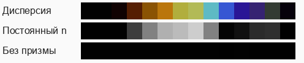

# Дисперсия призмы и свет в дымке

На стартовом ракурсе Prism видны три цветовые области изображения щели. Во Fractal temple дымка рассеивает солнечный свет в сторону камеры, и на тёмной поверхности виден луч, выходящий из отверстия. Эти наблюдения проверяет `./gradlew test --tests '*ShowcaseOpticsTest*' --tests '*ShowcaseShaderOpticsTest*'` на сценах, которые открывает приложение. CPU-тесты измеряют линейный RGB до экранной гаммы и ограничения яркости.

## Prism

Лампа стоит за щелью шириной 0,04 единицы. Камера смотрит через две боковые грани треугольной призмы. Лучи разных длин волн преломляются под разными углами. Чтобы камера увидела полосу некоторой длины волны, обратный луч должен пройти щель **и** попасть на светящуюся поверхность. У исходной лампы шириной 0,10 синяя часть пучка в центральном сечении проходила мимо лампы. Увеличение ширины до 0,36 сохранило резкую щель. Снижение интенсивности с 400 до 5 сохранило различимые цвета при переводе линейного сигнала в PNG. [Модель преломления в pbrt](https://www.pbr-book.org/4ed/Reflection_Models/Specular_Reflection_and_Transmission)

Для независимой геометрической оценки берётся горизонтальное сечение на высоте щели. Из точки (x, z) = (2, 1,95) луч последовательно пересекает две стороны треугольника из файла сцены. На каждой грани применяется закон Снеллиуса с индексом стекла n(λ) = 1,62 + 0,045·(1/λ² − 1/0,5876²), где λ измеряется в мкм. После выхода нужны три пересечения внутри отверстий: |z| < 0,02 при x = −1,57 и −1,63, затем |z| меньше половины ширины лампы при x = −2,3. Экранные координаты рассчитаны для ракурса 50°, кадра 320×180 и шага полпикселя. Лучи 650, 532 и 450 нм видят новую лампу около столбцов 160, 167 и 177 соответственно.

В таблице энергия канала суммируется по столбцам 146–180 и нормируется на красный канал. Геометрическая оценка суммирует принятые длины волн 380–720 нм с шагом 2 нм, весами RGB модели и цветом источника. Она учитывает прямое пропускание в горизонтальном сечении. Рендер дополнительно учитывает отражение, поглощение, среду, наклон лучей и конечную высоту щели. Измерение рендера усреднено по строкам 82–87, 128 сэмплов на пиксель, глубина 3. Это сравнение проверяет **расположение полос и относительный вклад каналов** в заданном участке. Для абсолютной фотометрии потребовались бы измеренные спектры лампы, стекла и сенсора.

| Источник | Геометрическая оценка R / G / B | Рендер krt R / G / B |
| --- | --- | --- |
| Ширина 0,10 | 1 / 0,49 / 0,001 | 1 / 0,46 / 0,005 |
| Ширина 0,36 | 1 / 1,06 / 0,78 | 1 / 1,17 / 0,93 |

В тесте три участка полосы должны быть одновременно яркими и иметь ожидаемый доминирующий канал. Если поставить для всех длин волн одинаковый индекс стекла, щель остаётся яркой, а центры трёх изображений совпадают с допуском ¼ пикселя. Если закрыть щель непрозрачной заслонкой при включённой лампе, сигнал падает ниже 0,01 по каждому каналу.

**Граница проверки каустики.** Здесь камера видит лампу через стекло. Для проверки каустики на матовом экране нужен другой путь: свет лампы сначала преломляется, освещает экран, а рассеянный экраном свет попадает в камеру. В Prism нет задней стены для такого измерения. По прямому изображению щели нельзя оценить яркость или сходимость проецируемой каустики. [Трудные световые пути и двунаправленная трассировка в pbrt](https://www.pbr-book.org/3ed-2018/Light_Transport_III_Bidirectional_Methods/Bidirectional_Path_Tracing)

## Каустика на отдельном матовом экране

Контрольная сцена использует корпус лампы и призму Prism. За щелью поставлена нейтральная лампа шириной 0,10. Белый матовый экран находится на расстоянии 1,75 от оси призмы в направлении 50° к падающему пучку. Небо чёрное. Ортографические лучи наблюдения начинаются в 0,05 перед экраном и попадают на его поверхность. Чтобы получить свет через стекло, обратному пути нужны четыре взаимодействия: экран, вход в призму, выход и лампа.

Каждая ячейка показывает средний цвет одного измеренного участка, 160 000 путей на участок. Центры участков от −0,525 до +0,45 с шагом 0,075 вдоль экрана. Для всех трёх строк применена одна экспозиция ×100 и экранная гамма 2. Верхняя строка показывает спектральную каустику, средняя — свет того же источника при постоянном индексе стекла, нижняя — фон на месте отклонённого пучка после удаления призмы.

| Участок экрана | Линейный R | G | B |
| --- | ---: | ---: | ---: |
| Слева, смещение −0,15 | 0,00534 | 0,00216 | 0,000023 |
| Справа, смещение +0,15 | 0,000472 | 0,00116 | 0,00688 |

Если разрешить только три взаимодействия, в правом участке остаётся по 0,00000028 на канал. Постоянный индекс 1,62 даёт нейтральный свет. Так каустика отделяется от прямого изображения лампы и окрашивания поверхности. Успешные пути редки, поэтому для устойчивого цвета участки усреднены по большой выборке. Запуск: `./gradlew test --tests '*ProjectedCausticTest*'`.

## Fractal temple

Солнце находится за губкой Менгера. Стартовая камера находится на расстоянии 4,88 от центра сферической дымки радиусом 4,5. Она смотрит через границу среды на освещённые проходы. Положительный параметр g функции Хеньи — Гринштейна повышает вероятность рассеяния в направлении распространения света. Для сравнения геометрию и освещение оставляем одинаковыми, а дымку удаляем или задаём ей g = 0 при прежней плотности и альбедо. [Фазовые функции в pbrt](https://www.pbr-book.org/4ed/Volume_Scattering/Phase_Functions) · [Перенос света в средах](https://www.pbr-book.org/4ed/Light_Transport_II_Volume_Rendering/Volume_Scattering_Integrators)

Тест сравнивает два участка 4×4 в строках 96–99 кадра 320×180. Первый лежит под выходом тоннеля (x = 160–163), второй — в соседней тени (x = 194–197). Измеряем Y = 0,2126R + 0,7152G + 0,0722B в линейном свете. При g = 0,75 добавленная средой яркость в луче должна превосходить 0,1 и минимум вдвое превышать как прибавку в соседней тени, так и прибавку при g = 0 в самом луче. Эти условия отличают пространственный луч от равномерного осветления картинки. Тест относится к однородной среде этой сцены.

## Проверка шейдера

Два теста исполняют рабочий SkSL через растровый конвейер Skia. Камера и координаты лучей соответствуют полному кадру 320×180. Поверхность имеет размер выбранного участка, а сдвиг холста сохраняет исходные координаты шейдера. Четыре серии по 32 сэмпла с фиксированными seed уменьшают шум. Для каждого участка сравниваются значения экранного RGB после обратного преобразования гаммы. Яркие значения здесь уже ограничены при переводе в восьмибитное изображение.

В Prism красная, зелёная и синяя области щели должны оставаться насыщенными и достаточно яркими. В Fractal temple тест сравнивает добавку яркости от дымки под выходом тоннеля и в соседней тени. Так можно выявить, например, перепутанный знак фазовой функции или потерю коротких волн в шейдере. Выполнение шейдера на видеокарте отдельно проверяет `./gradlew gpuSmoke`.
