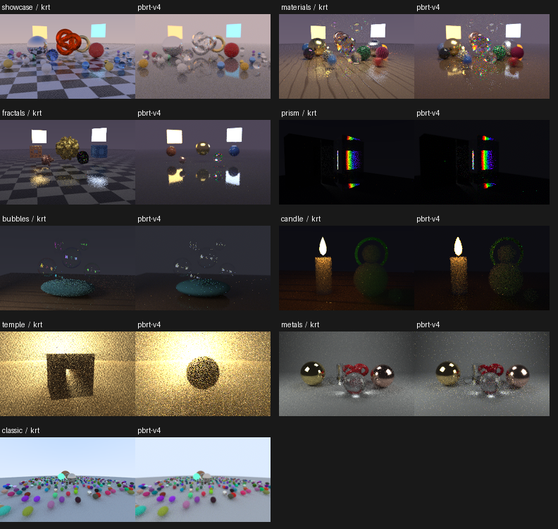

# Проверка изображения независимым рендерером

Для всех девяти встроенных сцен справа показан результат спектрального трассировщика pbrt-v4, слева — рендер krt со стартовой камеры. Для pbrt использованы исходные файлы из `src/main/resources/krt/scenes`, разрешение 192×120, 64 сэмпла на пиксель и seed 7. Слева уменьшены подробные CPU-эталоны 256×160. При сборке листа значения sRGB из pbrt переведены в экранную гамму 2, принятую в krt. Яркость экспозиции для каждой сцены сохранена. [Исходники независимого рендерера](https://github.com/mmp/pbrt-v4/tree/20e41fd83789f12550e2c31b2047898c9e20e46c)



| Сцена | Что видно при сравнении | Что ограничивает сравнение |
| --- | --- | --- |
| Showcase | Положение источников, узла и колец совпадает. | Клетки пола, покрытие пластика и градиент неба задают расширения krt. |
| Materials | Два прямоугольных источника и группы стеклянных и непрозрачных тел видны в обоих кадрах. | Процедурная древесина, тонкие плёнки и часть материалов используют замены при экспорте. По этому сравнению нельзя измерить амплитуду муара. |
| Fractals | Согласуются расположение объектов и освещение панелями. | pbrt читает ограничивающие сферы вместо четырёх фракталов. Форму отверстий проверяет собственный эталон krt. |
| Prism | Оба трассировщика разделяют цвета в изображении щели. | В pbrt показатель стекла задан таблицей по длинам волн. Точный порядок и относительную энергию полос krt дополнительно проверяет расчёт по Снеллиусу. |
| Bubbles | Видны подушка и блики от пузырей над ней. | Толщину мыльной плёнки и блеск бархата задают материалы krt. Цвета интерференции в двух файлах интерпретируются разными моделями. |
| Candle & jade | Источник ярче воска, свет просвечивает в телах рядом с пламенем. | Яркость зависит от параметров среды и числа сэмплов. Образцов реального воска с измеренными коэффициентами у сцены нет. |
| Fractal temple | Оба рендера показывают направленный свет в дымке. | Вместо губки Менгера pbrt рисует сферу. В krt расположение луча проверяется сравнением с той же геометрией при отключённой дымке и при изотропном рассеянии. |
| Metals | На шарах видны отражения студийных источников, форма блика зависит от материала. | RGB-аппроксимация оптических констант в krt ограничивает точность сравнения цвета со спектральным расчётом. |
| Classic spheres | Оба кадра показывают открытый горизонт и размещение групп шаров. | Стандартный файл описывает постоянный фон. krt добавляет градиент неба и свою модель шероховатого металла. |

## Контроль абсолютной освещённости

У контрольной сцены одна матовая плоскость с альбедо 0,7, одна смещённая квадратная лампа и чёрное окружение. Обе реализации читают один файл. Для эталона использованы pbrt-v4 указанной выше ревизии, 1024 сэмпла на пиксель, box-фильтр и глубина 2. Из корня проекта воспроизвести изображение можно следующими командами.

```sh
pbrt --quiet --seed 1 --outfile area.exr src/test/resources/optics/area-light.pbrt
imgtool convert --outfile area-light-pbrt.png area.exr
```

`PbrtAreaLightTest` декодирует sRGB эталона в линейную яркость и сравнивает каждый канал RGB на всех 64 участках 8×8 без подбора экспозиции. Допуск среднего участка равен 0,0005 плюс 4% от эталона. Проверяются CPU и растровое исполнение того же SkSL, который приложение передаёт Metal. `DiffuseRadianceTest` отдельно исключает ошибку, общую для двух рендереров: под небом с яркостью (1−cos θ)/2 идеальная белая ламбертовская плоскость даёт 1/6. Старая реализация давала около 0,10. [Ламбертовское отражение](https://pbr-book.org/4ed/Reflection_Models/Diffuse_Reflection) · [Проверки призмы и дымки](scene-optics.md)

Направление излучения проверено отдельным опытом. После разворота двух треугольников лампы внешний pbrt-вариант стенда даёт чёрный кадр по всем трём каналам. До разворота центральный пиксель был sRGB (37, 37, 36). `PbrtEmitterSideTest` проверяет это изменение освещения, прямой и зеркальный вид источника, включение двусторонности и сферу с перевёрнутой ориентацией. В новых экспортах krt сторона явно записана как `twosided`. [Площадные источники pbrt](https://pbr-book.org/4ed/Light_Sources/Area_Lights)

В штатных сценах и в контрольном стенде подложка источника чёрная. Во внешнем PBRT одна поверхность может и отражать падающий свет, и излучать собственный. При импорте такой поверхности krt сохраняет излучение и теряет отражение от подложки. Для произвольного источника с отражающим покрытием количественное совпадение с pbrt-v4 не установлено. Для проекции через призму на матовый экран отдельный тест измеряет положение и относительный цвет пятен. Эталон абсолютной яркости этой каустики отсутствует. [Проверка проекции](scene-optics.md)

## Численная устойчивость и стоимость

Проверки используют случаи с известным ответом. Для далёкой сферы длину хорды даёт геометрия окружности. Для вырожденного треугольника площадь и вероятность выбора в качестве лампы равны нулю. Нулевая экстинкция даёт пропускание 1 даже при бесконечном расстоянии. Интеграл фазовой функции по сфере равен 1, средний косинус рассеяния равен g. Отдельные примеры проверяют потерю значащих цифр, почти касательные лучи, исчезновение попадания при округлении границ BVH до float32, длинные узкие треугольники и яркий HDR-канал рядом со слабым. [Проверки вычислительного ядра](../src/test/kotlin/krt/domain/trace/NumericalReferenceTest.kt) · [Проверки численной устойчивости SkSL](../src/test/kotlin/krt/domain/render/GpuNumericalReferenceTest.kt)

Для проверки HDR небольшой треугольный источник освещает белый матовый приёмник с расстояния 32. При площади 1/32 ожидаемая линейная яркость в центре с относительной точностью 0,007% равна L·A/(π·32²). При излучении 4096, 8192 и 16384 она составляет 0,03979, 0,07958 и 0,15915. Раньше при увеличении мощности результат SkSL оставался около 0,04 из-за ограничения координатного формата сцены. Теперь каждый канал излучения хранит 8 бит экспоненты и 16 бит дробной части в одном текселе. Для нормальных значений float погрешность усечения при упаковке меньше 1/65536. Та же проверка охватывает цветной источник и светящийся узор. [Тест HDR-освещения](../src/test/kotlin/krt/domain/render/HdrAreaLightTest.kt)

Для ядра измерен JMH `TraceBenchmark.primaryRayHits`, по 10 000 первичных лучей за операцию. Два процесса JVM, в каждом три прогрева и пять замеров по 500 мс. В сцене demo среднее изменилось с 4,20 до 3,46 мс, при добавлении модели — с 14,37 до 11,43 мс. Интервалы погрешности JMH пересекаются в обоих случаях. Эти измерения не устанавливают ускорение и не измеряют частоту кадров окна.

`TraceBenchmark.frameSingleThread` измеряет трассировку целого CPU-кадра на одном потоке. Камера строит 160×160 пикселей с пятью лучами на пиксель и глубиной 7. Обе версии запускались на одной JVM Temurin 25 с G1, кучей 512 МиБ и фиксированными seed. В таблице приведены средние каждого из двух отдельных запусков JVM для каждой версии, в миллисекундах на кадр.

| Сцена | До, мс | После, мс |
| --- | ---: | ---: |
| Demo | 215 и 288 | 220 и 190 |
| Demo со стеклянной OBJ-моделью | 637 и 537 | 644 и 1511 |
| Та же OBJ-модель, повтор с более долгим прогревом | 553 и 777 | 514 и 512 |

В первой серии версии шли в порядке «до, после, после, до», по три прогрева и пять замеров длительностью 750 мс. Большой разброс на OBJ совпал с фоновой нагрузкой. При повторе версии чередовали, в каждом процессе было четыре прогрева и пять замеров по одной секунде. В контрольной паре после завершения параллельных графических тестов время составило 527 ± 8 мс до и 508 ± 22 мс после изменений (интервал JMH 99,9% внутри каждой JVM). Замедление до 1511 мс в повторе не воспроизвелось. Разброс между JVM ограничивает точность сравнения. Время вывода готового кадра и работу GPU этот тест не охватывает. [Код бенчмарка](../src/jmh/kotlin/krt/bench/TraceBenchmark.kt)
