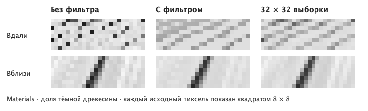

# Фильтрация древесины

Опция `Filter distant wood grain` в сцене Materials сохраняет различимые волокна вблизи и усредняет рисунок там, где пиксель покрывает несколько годичных колец. На рисунке показана доля тёмной древесины до освещения. Каждый фрагмент исходного изображения занимает 24×8 пикселей и увеличен без интерполяции.

## Как считается

Для двух осей пикселя камера даёт изменения направления луча $dD$. В точке попадания с параметром $t$ и нормалью $N$ смещение по поверхности равно $dP=t(dD-D(N\cdot dD)/(N\cdot D))$. Так передний план получает маленький участок текстуры, а при взгляде вдоль пола участок вытягивается в глубину. У быстрого предпросмотра размер пикселя соответствует разрешению предпросмотра. [PBRT, Texture Sampling and Antialiasing](https://pbr-book.org/4ed/Textures_and_Materials/Texture_Sampling_and_Antialiasing)

В пространстве текстуры два смещения дают оценку разброса фазы колец. Для радиальной части используется производная расстояния до оси ствола. Для волнистости вклад растёт с проекцией пикселя на решётку шума и ограничен амплитудой волны. Кубический профиль кольца интегрируется по интервалу соответствующей ширины. При ширине от 32 периодов используется средняя доля поздней древесины за период, 0,14. У тонких волокон амплитуда шума плавно снижается от полной при ширине ≤ 0,25 ячейки до нуля при ширине ≥ 2 ячеек. Bump берёт конечные разности этого же отфильтрованного рисунка.

## Что проверяют эталоны

Встроенная сцена Materials даёт два участка сферического пола в изображении 256×160. Координаты верхних левых углов — (3, 65) и (16, 124). Каждый эталонный пиксель усредняет 32×32 отдельных пересечения лучей с исходной геометрией при фиксированной точке апертуры. Тест заново сверяет каждое 16-битное значение PNG. Средняя абсолютная ошибка доли тёмной древесины вдали уменьшилась с 0,0901 до 0,0424, вблизи — с 0,0136 до 0,0129. [Тест на исходной сцене](../src/test/kotlin/krt/domain/render/WoodMaterialsGoldenTest.kt)

На тестовой плоскости CPU и SkSL считают первичные лучи при одной выборке на пиксель. Белое небо даёт нейтральное отражение от лака, а древесина меняет только красный канал. Так тест сопоставляет диффузный цвет с эталоном независимо от случайного числа отражений от лака. Размытие всего пола до постоянного цвета проваливает проверку ближних волокон. При смещении камеры на 0,045 единицы вдоль пола проверяется разность двух кадров относительно разности двух эталонов с тем же движением. Ошибка изменения доли древесины на CPU снизилась с 0,1314 до 0,0272, на SkSL — с 0,1416 до 0,0253. [Проверки кадра и движения](../src/test/kotlin/krt/domain/render/WoodFootprintGoldenTest.kt)

Отдельные численные тесты сравнивают проекции с конечными разностями соседних лучей, интеграл кольца с плотной квадратурой, дальнюю bump-нормаль со средним по периоду. [Проверки математики](../src/test/kotlin/krt/domain/scene/model/WoodGrainTest.kt)

## Границы метода

Фильтр применяется к первому видимому попаданию луча камеры в покрытую лаком древесину. Неизменившийся луч сохраняет полный путь от объектива через границы сред. На гладком меше размер участка определяется геометрической плоскостью треугольника, а освещение использует интерполированные нормали. Отражённые, преломлённые и рассеянные лучи продолжают точечную выборку. У силуэтов и сильной кривизны касательная плоскость лишь приближает форму поверхности. Затухание тонкого шума и ширина волнистых колец также приближённые. Для оценки шума освещения, отражений и глубины резкости нужны законченные кадры с накоплением выборок.

## Время рендера

На Metal для Materials при 1024×1024, 12 выборках и глубине 7 после прогрева оба режима получили одну и ту же последовательность лучей камеры. В серии «выкл., вкл., вкл., выкл.» полные кадры заняли 15,529, 14,107, 13,931 и 13,981 с. Среднее двух повторов составило 14,755 с без фильтра и 14,019 с с фильтром. Медианы времени аппаратного шага лежали в диапазоне 25,6–26,2 мс. Первый холодный шаг общего шейдера перед серией занял 2,52 с. Два повтора на одной машине характеризуют этот конкретный замер.

На CPU тот же пресет с его штатной апертурой проверен при 256×256, восьми выборках и глубине 7 через обычный планировщик. После двух прогревов проведены четыре пары с одинаковым seed и чередованием порядка. Медиана времени до первого предпросмотра составила 8 мс без фильтра и 7 мс с фильтром. Медиана времени до завершения составила соответственно 815 и 804 мс, включая обычную задержку перед уточнением. Диапазоны полного времени — 710–1207 и 773–851 мс. Разброс превышает разницу медиан.
