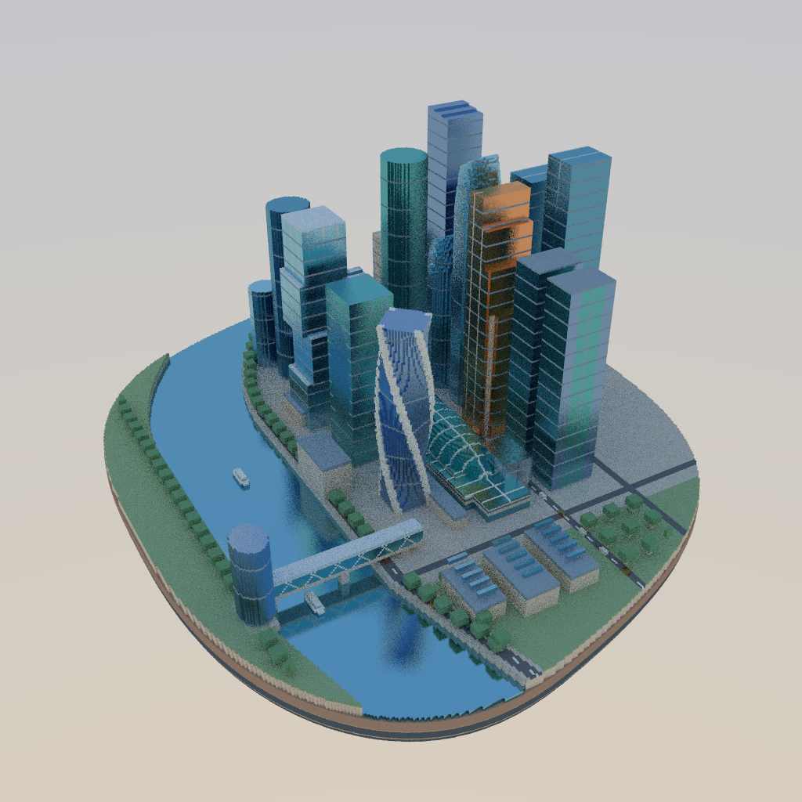
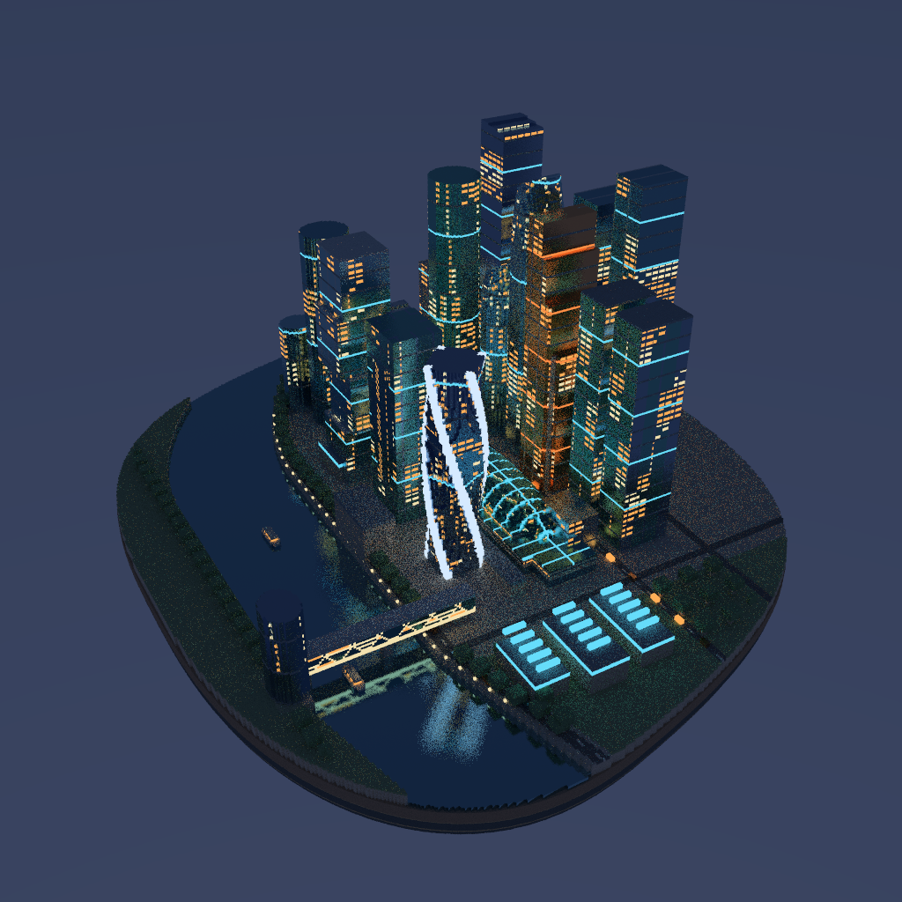

# Воксельная Москва-Сити

Кнопкой **Open scene…** откройте [дневную](moscow-city.pbrt) или [ночную](moscow-city-night.pbrt) версию. Для кадра ниже на вкладке **Render** выставьте 1024×1024, **Samples per pixel** 10 и **Max bounces** 10. krt берёт положение камеры из файла и сохраняет текущие настройки вкладки Render. Сцена самодостаточна и открывается без сети.

В ночной версии тёплые окна перемежаются тёмными этажами. Спираль «Эволюции», купол Афимолла, переплёт моста, фонари набережной и каюты речных судов излучают свет. Их отражения меняются при движении камеры.

В центре диорамы расположен Афимолл. Его можно найти по длинной бирюзовой крыше с белыми рёбрами между медной башней «Меркурий» и спиральной «Эволюцией». От набережной мост «Багратион» ведёт к Башне 2000 на другом берегу. На заднем плане видны пары башен «Федерация», ОКО и Neva Towers. В макет также вошли «Город столиц», «Империя», «Евразия», башни на Набережной, IQ-квартал, Moscow Towers, Северная башня, City Point и выставочные павильоны.

Положение кварталов и ход набережной восстановлены по схеме района. Высоты башен округлены до вокселя. Шаг воксельной сетки башен, атриума, моста и береговой линии составляет 2,5 м. Декоративный профиль цоколя построен по 128 точкам контура. Ширина улиц, очертания участков и второстепенные постройки стилизованы. Район заканчивается фигурным срезом с углублённым руслом, тёмным цоколем и двумя охристыми полосами.

Соседние открытые грани одного материала объединены в прямоугольники. Блики на фасадах и отражение моста в реке считает трассировщик. Материалы различаются цветом и шероховатостью. Площадной источник освещает башни сбоку и даёт тени на набережной.

## Архитектурные источники

- Расстановка кварталов, вытянутый корпус Афимолла, положение «Эволюции» и подход к мосту показаны на первой странице. [Схема Москва-Сити, ФКУ «ГосТех»](https://platform.gov.ru/wp-content/uploads/2023/10/shema-proezda_city.pdf)
- Высоты башен, состав парных и тройных комплексов и фотографии фасадов приведены в каталоге района. [Москва-Сити, каталог башен](https://www.citymoscow.ru/about/towers)
- Спиральный объём и четыре угловые полосы «Эволюции» построены по описанию проектировщика. [ГОРПРОЕКТ, Evolution Tower](https://gorproject.ru/en/projects/evolution-tower/)

## Контрольный кадр

Первый полный рендер каждой версии в стартовом ракурсе при 1024×1024, 10 выборках на пиксель и глубине 10:

| Сцена | Треугольники | CPU, 10 потоков | GPU, Metal |
| --- | ---: | ---: | ---: |
| Дневная | 41 896 | 40,7 с | 47,7 с |
| Ночная | 54 744 | 42,2 с | 39,7 с |

Каждый замер начат в отдельном процессе перед чтением файла сцены и закончен после десятого прохода штатного планировщика. Время зависит от оборудования и ракурса.

Тесты импорта строят уменьшенные кадры обеих сцен и сравнивают локальные средние RGB в линейном свете с соответствующими изображениями выше. Для запуска используйте `./gradlew --offline test --tests '*MoscowCitySceneTest'`.
